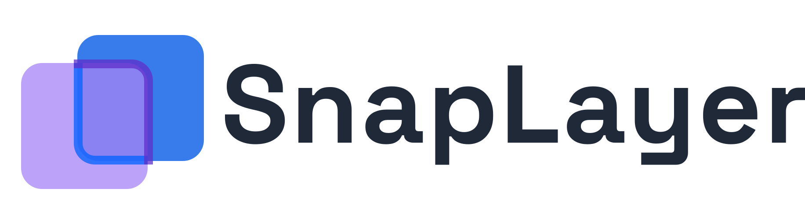

<picture>
  <source media="(prefers-color-scheme: dark)" srcset="/public/logo-dark.svg">
  
</picture>

[](https://github.com/muleyuck/SnapLayer/actions/workflows/unit-test.yml)

[](https://github.com/muleyuck/SnapLayer/releases/latest)

🎞️ A Chrome extension that lets you overlay JPEG/PNG/SVG images and HTML mockups on any webpage.
Perfect for designers comparing mockups, developers checking pixel-perfect implementations, or anyone who needs to visually compare images against web content. No more switching tabs — compare side by side in real time.

## Screenshots


## Features

- **Drag & Drop Positioning** - Move the overlay anywhere on the page
- **8-Direction Resizing** - Resize from any corner or edge
- **Aspect Ratio Lock** - Maintain proportions while resizing (toggleable)
- **Opacity Control** - Adjust transparency for easy comparison
- **Visibility Toggle** - Quickly show/hide the overlay
- **JPEG/PNG & SVG Support** - Works with common image formats
- **HTML Mockups** - Load a single HTML file with CSS, images and rendering scripts; change its viewport dimensions and scroll within the overlay
- **Style Isolation** - Shadow DOM ensures no conflicts with host page styles
- **Keyboard Shortcuts** - Move with arrow keys; Shift+arrow for 10 px jumps; Backspace or Delete to delete
- **Clipboard Paste** - Paste images with Cmd/Ctrl+V, including SVG as plain text
- **Fit to Viewport** - Expand image to fill the viewport width and toggle back to original size
- **Manual Size Input** - Type exact pixel dimensions directly in the toolbar

## Installation

### Recommend

- [Chrome Web Store](https://chromewebstore.google.com/detail/snaplayer/mlfijeojnbmhecfigldlcmjfjbcdgpgm)

### Optional (Manual install from source)

1. Clone or download this repository
2. Build the extension:
   ```bash
   npm install
   npm run build
   ```
3. Open Chrome and navigate to `chrome://extensions/`
4. Enable **Developer mode** (toggle in top-right corner)
5. Click **Load unpacked** and select the `dist/` folder

## Usage

1. Click the SnapLayer extension icon in Chrome toolbar
2. Select a JPEG, PNG, SVG or HTML file from your computer
3. The file appears as an overlay on the current page
4. **Move**: Drag the grip at the left of the toolbar to reposition any layer; images can also be dragged directly
5. **Resize**: Drag the corner or edge handles
6. **Adjust**: Use the toolbar to change opacity, toggle visibility, or delete

### Toolbar Controls

| Control | Description |
|---------|-------------|
| Grip Icon | Drag to move the layer (images, SVG and HTML) |
| Width / Height | Enter exact pixel dimensions |
| Expand Icon | Fit to viewport width (click again to restore) |
| Opacity Slider | Adjust image transparency (0-100%) |
| Lock Icon | Toggle aspect ratio lock |
| Eye Icon | Toggle image visibility |
| Trash Icon | Remove the overlay |

### HTML mockups

Select an `.html` or `.htm` file using the same file picker. HTML starts at a 640 × 480 viewport with the aspect ratio unlocked. Width and height change the actual viewport, so responsive layouts reflow instead of scaling. Scroll over the HTML to scroll the mockup, and drag an outer edge or the toolbar background to move the overlay. The toolbar background remains draggable when collapsed. Hiding the layer keeps its document mounted.

SnapLayer reads the file locally. The mockup can execute inline scripts and load HTTPS styles, scripts, images and fonts; those requests go to the referenced servers. Relative companion files are not imported. External frames, authentication and persistent storage are outside the supported preview use case. Clipboard paste continues to support images and SVG text.

Uploaded HTML runs inside a manifest sandbox with an opaque origin, without extension APIs or direct access to the comparison page. The extension uses only `activeTab` and `scripting`; HTML previews do not require tab capture or additional host permissions. Resource loading still follows the remote server's browser access restrictions.

## Keyboard Shortcuts

Drag any of the four outer edges to move an image, SVG or HTML layer. The square handles resize it. The toolbar stays within the viewport and its background remains draggable when the edges are offscreen. Buttons and inputs keep their normal actions.

Click an edge, the toolbar background or a resize handle to focus the layer. Shortcuts apply while the layer or its controls are focused; editing a toolbar input keeps its native key behavior. Keys pressed inside an HTML mockup are handled by that HTML.

| Key | Action |
|-----|--------|
| Arrow keys | Move overlay 1 px |
| Shift + Arrow keys | Move overlay 10 px |
| Backspace / Delete | Remove overlay |
| Cmd/Ctrl + V | Paste image from clipboard |

## License

[The MIT Licence](https://github.com/muleyuck/SnapLayer/blob/main/LICENSE)
